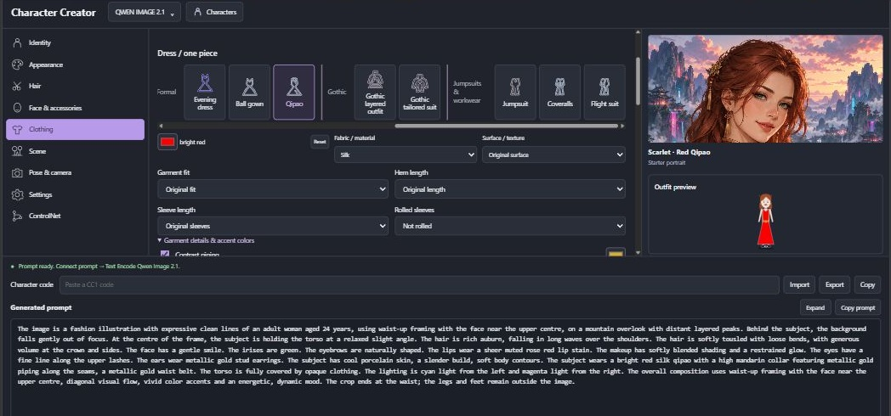
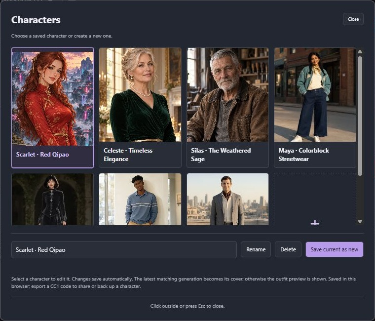
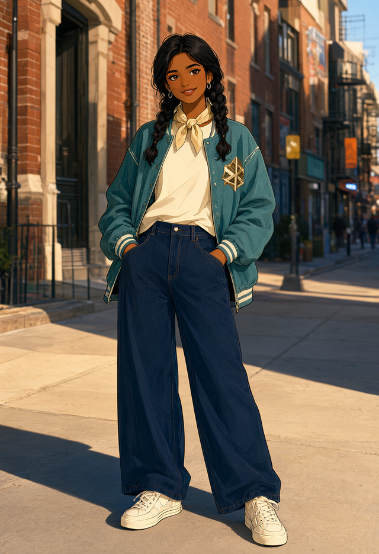
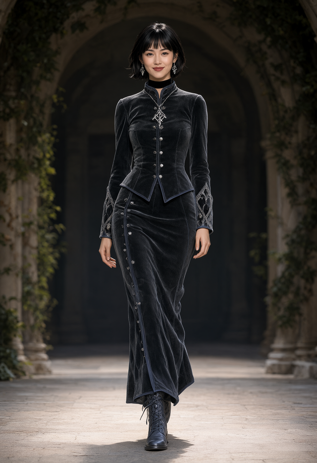
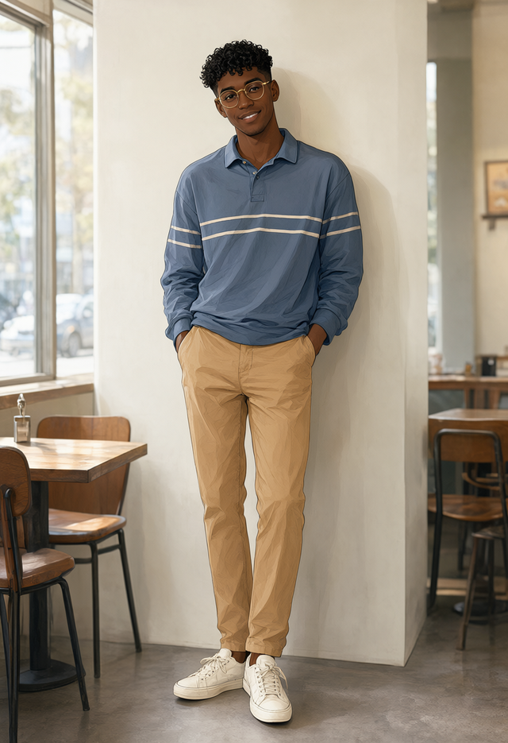
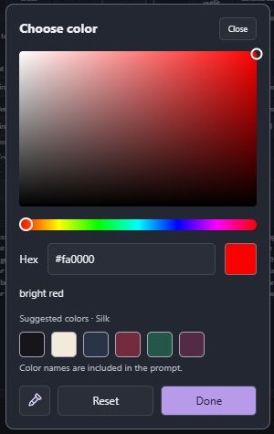
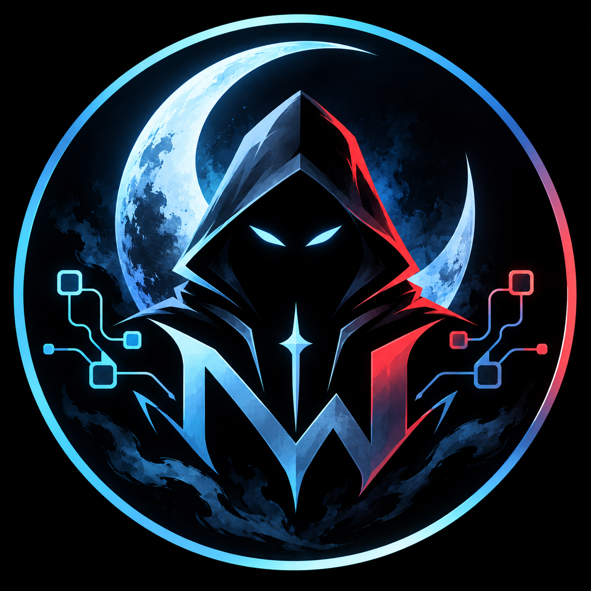

# Character Creator for ComfyUI

Build a character visually, then send the prompt straight into your image workflow.

**Qwen Image 2.1 · SDXL · Stable Diffusion 1.5**



## Make it yours

- **Design the character:** adult age, appearance, ethnicity, body shape, hair, eyes, makeup and accessories.
- **Build the outfit:** separates or one-piece clothing, shoes, gloves, neckwear and headwear, with fabrics, textures and colored details.
- **Set the scene:** backgrounds, art styles, lighting, poses, framing and composition.
- **Pick any color:** use the color picker or enter a hex value; the creator turns it into words for the prompt.
- **Save and share:** name characters in your local library, or export a character code for someone else to import.
- **Guide the result:** connect one or more compatible ControlNets and adjust their strength and timing.

Prompts update as you edit. Expand or copy the text, and choose a template in **Settings** to emphasize the character, outfit, face, build or scene.

## Install

You need a current ComfyUI installation and model weights for your chosen family.

Find **Character Creator** in [Comfy Registry](https://registry.comfy.org/nodes/character-creator), or install directly from GitHub. Open a terminal in `ComfyUI/custom_nodes` and run:

```sh
git clone https://github.com/NightWarrior/comfyui-character-creator.git
```

Restart ComfyUI and refresh its browser page. The addon itself needs no extra Python packages and does not download models.

## Your first character

1. Drag an [example workflow](examples/) into ComfyUI, then select your installed model files in its loader nodes.
2. Open **Character Creator** and choose the model family using the button at the top. Match it to the workflow you loaded.
3. Choose one of the seven starters in **Characters**, or use **+** to create your own. Scarlet is the starting default. Browse the left rail to edit their look.
4. Click **Run** in ComfyUI. The workflow encodes the prompt and generates the image.

Using your own workflow? Add **Character Creator** from node search. Connect `prompt` to your positive text encoder and `negative_prompt` to your negative text encoder. Convert a text widget to an input first if needed.

The family button changes prompt formatting; it does not switch checkpoints or rebuild your workflow. SD/SDXL get positive and negative prompts. Qwen currently supplies an empty negative prompt.

## Save your cast



Open **Characters** to select, create, rename or delete characters. Edits save automatically, and the latest matching generated image becomes the character's cover. Seven starters showcase different ages and fashion styles. New starters are added once to existing libraries without replacing your characters or restoring ones you deleted.

| Maya · Streetwear | Raven · Velvet gothic | Leo · Campus casual | Adrian · Modern tailoring |
| --- | --- | --- | --- |
|  |  |  |  |

The library is saved in your current browser. Click **Export**, then **Copy**, to back up or share a `CC1…` character code; paste it and click **Import** to load it elsewhere. Codes contain character settings, not images, model files or ControlNet connections.

<details>
<summary><strong>Colors, materials and finishing touches</strong></summary>



Click a color swatch to choose a color, try suggested colors for that item and material, type its hex value, or sample a screen color with the **eyedropper icon** in a compatible browser. **Reset** restores the default.

Clothing offers fabrics, textures, accent colors and garment-specific modifications: fastening, fit, hem length, sleeves and rolled sleeves. Try cotton, denim, linen, velvet, silk, leather, metallic or holographic finishes.

**Neckwear** has chokers, scarves, mufflers, ties and cowls, with color, material, wrapping and fastening options. Necklaces and earrings stay under **Face & accessories**. The one-piece menu also includes gothic layered and tailored outfits with adjustable fit, sleeves, lacing and accent details.

</details>

## Example workflows

Download a JSON from [examples](examples/) and drag it into ComfyUI.

| Workflow | What to use it for |
| --- | --- |
| [Qwen Image 2.1](examples/Qwen%20Image%202.1%20-%20Character%20Creator.json) | Standard Qwen generation; select your Qwen model, text encoder and VAE. |
| [SDXL / Juggernaut XL](examples/SDXL%20-%20Juggernaut%20XL%20-%20Character%20Creator.json) | SDXL generation; select your SDXL checkpoint. |
| [SD 1.5 / DreamShaper 8](examples/SD%201.5%20-%20DreamShaper%208%20-%20Character%20Creator.json) | SD 1.5 generation; select your SD 1.5 checkpoint. |
| [Qwen ControlNet test](examples/Qwen%20Image%202.1%20-%20Character%20Creator%20ControlNet%20Test.json) | Turn a source image into a guide, then use it to control generation. |

The SD/SDXL examples come with the named checkpoint selected; you can substitute another checkpoint from the same family and adjust sampling settings to suit it. Model weights are not included.

**Compact** workflows: [Qwen](examples/Qwen%20Image%202.1%20-%20Character%20Creator%20Compact.json), [SDXL](examples/SDXL%20-%20Juggernaut%20XL%20-%20Character%20Creator%20Compact.json), and [SD 1.5](examples/SD%201.5%20-%20DreamShaper%208%20-%20Character%20Creator%20Compact.json). They keep the creator visible and group generation inside a ComfyUI subgraph. Double-click the subgraph to inspect or change it.

### Try ControlNet

For the Qwen test workflow:

1. Install [comfyui_controlnet_aux](https://github.com/Fannovel16/comfyui_controlnet_aux) and download the compatible [Qwen Image 2.1 Fun ControlNet Union](https://huggingface.co/alibaba-pai/Qwen-Image-2.1-Fun-Controlnet-Union) weights into `ComfyUI/models/model_patches/`.
2. Load the test workflow, select your Qwen files and the Union patch, then upload a source photo in **Load Image**.
3. Choose a supported converter in **AIO Aux Preprocessor**: start with **Canny**. Depth, pose, line art and other converters may need their own detector weights.
4. Enable the creator's **ControlNet** controls and run. **Preview Image** shows the converted guide. Keep the guide-size links connected so the output uses the same aspect ratio.

For multiple guides, duplicate the preprocessor and control entry, then connect each entry to the creator's next empty socket. Use weights compatible with your model family; SD/SDXL ControlNets cannot be used with Qwen.

## Good to know

- The small outfit preview is a schematic. The portrait is a starter image or a previous result; neither predicts the next generation. Exact details depend on your image model.
- Characters are adults, aged **18–100**. Clothing coverage is required by default. An explicit local `"allow_nsfw": true` setting in `config.json` unlocks all wardrobe combinations; shared character codes cannot enable it.
- Want your own options or prompt templates? Copy [config.example.json](config.example.json) to `config.json`, customize it, then restart ComfyUI and refresh the page. Your local config stays out of Git.
- Character creation is free. Optional support links are tucked away in **Settings**.

[Report an issue](https://github.com/NightWarrior/comfyui-character-creator/issues) · [MIT license](LICENSE) · [Third-party notices](THIRD_PARTY_NOTICES.md)

## Made for your imagination.




Enjoying Character Creator? Your support helps me improve the node, explore new features, and keep development going.

[**Support Development on Patreon**](https://patreon.com/NightWarrior) · [View on GitHub](https://github.com/NightWarrior/comfyui-character-creator)

Character Creator by NightWarrior · Built for ComfyUI
