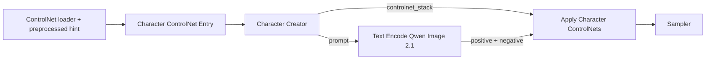

# Character Creator for ComfyUI

An adult character creator with on-node category navigation, local vector option icons, a schematic outfit preview, configurable templates, shareable character codes and an optional ordered ControlNet stack. Prompt adapters support **Qwen Image 2.1, SDXL and Stable Diffusion 1.5**. There are no added Python dependencies, model downloads or outbound requests.

## Install

Clone this repository into your ComfyUI installation's `custom_nodes` directory:

```powershell
git clone https://github.com/NightWarrior/comfyui-character-creator.git
```

Restart ComfyUI after installation and refresh its browser page. No additional
Python packages are required by this addon. Use a current ComfyUI build with the
`comfy_api.latest` dynamic-input API. Example workflows also need the model weights
and any external encoder/preprocessor nodes described below; these are not bundled.

## Use

This folder belongs directly in `ComfyUI/custom_nodes/`. Restart ComfyUI and refresh the frontend after installation. Search for **Character Creator · Qwen Image 2.1** in the **Character Creator** category.

1. Select a category in the left rail, then choose visual options. The right-hand preview is a schematic of hair, skin and clothing, separate from the generated character portrait. Build, expression, pose, style and camera choices are represented by option icons and prompt prose; the schematic does not simulate them.
2. Choose **Separates** or **Dress / one piece** under Clothing. Only active garments appear in the prompt. Native widgets are hidden behind the visual editor while their values and connection sockets remain available for API use and workflow serialization.
3. Connect `prompt` to `Text Encode Qwen Image 2.1.prompt`. If the encoder's prompt is a widget, convert it to an input using the node's widget menu. Keep CLIP, VAE, negative prompt, latent sizing and sampling in your existing workflow.
4. **Export** puts a canonical `CC1.…` string in the share box; **Copy** copies it. Paste a code and press **Import** to replace the character controls. The second node output exports the same format for automation.
5. Read the generated prompt in its scrollable text area, use **Expand** to open a larger read-only dialog, or **Copy prompt** to copy the full text. The schematic uses fitted garment shapes in the avatar's coordinate space, including a separate shoe on each foot.

The **Settings** category contains the prompt template selector and explanations for every layout: Character portrait (general layout), Outfit study (wardrobe first), Face study (face and hair first), Build study (body and clothing fit first), and Scene study (environment and lighting first). Templates reorder the same selected details; they do not change pose, framing, clothing or add extra views. Select a layout to read its full explanation.

Settings also contains **Highlight prompt changes** and **Auto-scroll to changes**, both on by default. Auto-scroll applies to highlighted text; disabling highlights disables its control while retaining the saved preference. Reader preferences are stored per node in the workflow. CC1 character codes continue to store the selected template and character choices, without reader preferences.

When a setting changes the generated prompt, added or replaced words receive a temporary highlight and the prompt scrolls to the first change. The highlight stays visible for three seconds, then fades. Removing an option, disabling a garment detail or resetting an override does not highlight the resulting prose. The expanded prompt uses the same highlights; text stays selectable and Copy prompt copies plain text.

Age uses an **18–100 slider** with an editable number on its right. Committing a number below 18 changes it to 18; values above 100 become 100. The same bounds apply to prompt generation and imported/exported codes, including when NSFW wardrobe options are enabled. Numeric age is included in the prompt. Existing codes containing only a life-stage preset remain readable; importing one into the new editor selects a representative adult age for that stage.

**Breast size** appears only for Female. Small, Medium and Large describe the fit of an opaque covering garment and change the schematic's chest contour. Head-and-shoulders portraits omit bust descriptions. Male prompts omit breast-size descriptions even if the saved character retains a prior female size. These are prompt instructions and a schematic, not a guarantee of the image model's result.

**Ethnicity / heritage** is an optional Appearance selector, defaulting to Unspecified. It adds only the selected heritage description to the prompt. Skin color, facial expression, body shape, hair and wardrobe remain independently selectable. CC1 codes include a selected heritage; older codes reset it to Unspecified. The optional native `ethnicity` combo is appended after the existing inputs to preserve saved widget order.

Ethnicity choices are organized into 12 collapsible sections: General, Africa, five Asian subregions, Europe, North America, Latin America/Caribbean, Oceania/Australia and cross-regional identities. There are 205 choices including Unspecified and Mixed; broad regional choices sit alongside more specific cultural and national-origin descriptions. The selected section opens automatically. Existing option IDs and saved character codes remain valid. [UN geographic regions](https://unstats.un.org/unsd/methodology/m49/) informed the navigation, with [Smithsonian NMAI naming references](https://americanindian.si.edu/nk360/faq/did-you-know) for Indigenous identities; sections organize browsing and do not restrict appearance choices.

Hairstyles have sections for modern cuts, classic cuts, long/layered styles, curls/coils, braids/locs/protective styles, tied styles and bald heads. Cultural context uses neutral names and follows [Smithsonian's discussion of Black hair traditions](https://nmaahc.si.edu/explore/stories/strands-of-inspiration); heritage does not restrict the hair menu. Existing Male/Female menu differences still apply. Custom hairstyles appear under Other styles.

None appears first wherever available, while existing selections and explicit defaults stay unchanged. Icon tiles keep the chosen swatch color with a light contrasting outline; hairstyle icons show a separate neutral face fill and use the current hair color for their strokes. Garment variants, expressions, body types, lighting and framing have distinct drawings. The schematic preview retains its existing fitted garment shapes.

Male and Female use different preview silhouettes and hairstyle/clothing menus, with shared basics where appropriate. Male options include crew cut, side part, undercut, slicked-back hair, polo/Henley shirts, cargo shorts, loafers and work overalls. Changing gender in the visual editor replaces choices outside the new menu with that menu's first option, while keeping shared choices and color overrides. Connected fields and explicitly imported presets retain their supplied values; the menus do not impose new backend restrictions on existing characters.

The lists are configured per field in `catalog.json` using `gender_options`, keyed by the existing `man` and `woman` IDs. Custom options added through `config.json` are shared unless listed in one of those menus. These lists are field metadata supported by the existing catalog loader, so loading the updated frontend does not require restarting a running ComfyUI server.

The native optional `character_code` input accepts a connected STRING or pasted code. A nonempty code overrides all character controls at execution; importing it through the panel applies its settings to widgets and clears that override. A connected code cannot be overwritten by the panel. Codes are base64-encoded JSON, not encrypted. They contain character option IDs, model and template, not model weights, images, ControlNet graph connections, local policy or custom catalog definitions. Recipients need the same custom definitions to use custom IDs. Unknown fields, options and versions fail clearly.

## Model families and compact workflows

Click the model-family button at the top of the editor. Qwen Image 2.1, SDXL and Stable Diffusion 1.5 are enabled when the backend exposes their adapters; Z-Image Turbo, FLUX and SD3 remain disabled. Outside clicks dismiss the picker. This changes prompt formatting, not graph loaders or checkpoint weights. A connected model/code input or pasted overriding code locks the picker. SD/SDXL use concise comma-separated descriptions; Qwen keeps its descriptive paragraph. All adapters share the same selections, adult/wardrobe policy, colors, garment details and crop-aware descriptions. CLIP may use multiple chunks for detailed characters; no artificial token truncation is applied.

The installed workflows are in `user/default/workflows/Character Creator/`, with identical files in `examples/`:

- **SDXL - Juggernaut XL - Character Creator.json**: installed Juggernaut XL v9 RunDiffusion Photo v2 checkpoint, bundled CLIP/VAE, 832 × 1216, 35 DPM++ 2M Karras steps, CFG 5.
- **SD 1.5 - DreamShaper 8 - Character Creator.json**: installed DreamShaper 8 checkpoint, bundled CLIP/VAE, 512 × 768, 25 DPM++ 2M Karras steps, CFG 7.
- **Qwen Image 2.1 - Character Creator Compact.json**, **SDXL - Juggernaut XL - Character Creator Compact.json**, and **SD 1.5 - DreamShaper 8 - Character Creator Compact.json**: native subgraph prototypes. The full visual creator stays on the outer graph. Loading, encoding, optional controls, sampling and decoding are encapsulated in a generation subgraph with IMAGE output, followed by Save Image. Positive prompt, negative prompt and control stack are connected; width, height, seed, steps and CFG are exposed, plus checkpoint choice for SD/SDXL. Disconnect negative_prompt to enter your own negative text. Qwen filenames are preselected inside its subgraph. Double-click to inspect internals. These use native subgraph boundaries, without legacy proxyWidgets or a new backend pipeline node.

Sources: [Juggernaut v9 recommended settings](https://huggingface.co/RunDiffusion/Juggernaut-XL-v9), [DreamShaper 8 model card](https://huggingface.co/Lykon/dreamshaper-8), [ComfyUI subgraphs](https://docs.comfy.org/interface/features/subgraph). DreamShaper's dimensions/CFG/sampler here are practical starting choices, not a claim that its publisher prescribes them. The creator supplies negative text automatically; see below. Match ControlNet weights to the selected family; SD/SDXL use classic conditioning controls, and Qwen Union uses native model patches. Checkpoint headers were verified without loading tensors. Graph links, boundaries, promoted controls and prompt behavior are unit-tested. The subgraphs are prototypes: no live UI, generation or image-quality test was run. Backend family changes require a ComfyUI restart when convenient; this task does not restart the current instance.

The appended **negative_prompt** STRING output preserves the indices of prompt (0), character_code (1) and controlnet_stack (2); negative_prompt is output 3. SD/SDXL generate concise exclusions for artifacts, conflicting art styles and full-body framing when cropped. SD 1.5 adds a few extra anatomy/resolution terms; SDXL stays more restrained. Uncovered-chest/genital exclusions apply only while local NSFW wardrobe policy is disabled. This is deterministic guidance, not an image-safety guarantee. Qwen currently outputs an empty string, preserving its existing example behavior. No negative embeddings or extra models are required.

All supplied workflows connect this output to negative text encoding, including compact subgraph boundaries. Disconnect that link to use custom negative text, or route it through an existing string-combination node to append your own terms. Previously saved workflows keep their original wiring until you connect the new output or load an updated example. The generated-prompt reader continues to display the positive prompt. Backend output changes require a normal ComfyUI restart; no restart is performed automatically.

A detailed, copyable feature description is in `FEATURES.txt`.

## Example workflow

Load `examples/Qwen Image 2.1 - Character Creator.json` in ComfyUI. This installation also has a copy in `user/default/workflows/qwen 2.1/`. The workflow connects the creator to Qwen text encoding, the optional ControlNet application stage, sampling, VAE decoding and Save Image. Its three model filenames match this installation: Qwen Image 2.1 INT8, Qwen3-VL 8B INT8 and the Qwen Image 2.1 BF16 VAE. Other installations must choose their own installed filenames.

The example reuses the existing local Qwen workflow's 25-step Euler/simple sampler, CFG 1 and 1024-square canvas, with seed 42 fixed for repeatability. ControlNets start disabled; the stack-to-application wiring is already present. No extra custom-node package is required beyond Character Creator. Encoding and ControlNet application use separate nodes.

## Hair, face and accessories

Hair has separate finish and volume controls: neatly groomed, messy, tousled, windblown, sleek, wet look and flyaways; low, airy and generous volume. Bald heads hide these controls and omit their prompt phrases. None preserves the original hairstyle description.

The **Face & accessories** category includes eye color/shape, eyebrows, lip shape/color/finish, makeup, eyeliner, earrings, necklaces, facial piercings, beauty marks, freckles and eyewear. These options are independent of gender and heritage. Eye color, lip makeup and colored accessories have the same color popups and verbal color dictionary as clothes. Clothing includes leather, knitted, fingerless, opera, lined lace, work, sport and fantasy gauntlet gloves, with fabric, texture and accent refinements. Every new field defaults to None, remains optional in old codes/workflows and is included when chosen in exported CC1 codes.

The schematic shows glove pairs, iris/lip colors, brows, selected face marks, eyewear, jewelry and several hair-finish accents. It is not a detailed simulation of makeup, lip shape, eye shape or fabric draping; the complete selected descriptions appear in the generated prompt.

## Characters and support

New nodes and both example workflows start with **Scarlet**, an adult woman aged 24 in a vivid red silk qipao with metallic-gold piping and belt, auburn waves and soft-glam makeup, rendered as a fashion illustration on a mountain overlook with cyan/magenta neon lighting and a dynamic mood. The **Characters** button opens a four-column library with Scarlet, **Celeste** (an elegant woman aged 52), and **Silas** (a thoughtful man aged 78 in workwear). Every starter uses existing creator options; definitions are in `web/characters.json`. Existing nodes retain their saved selections. The editor resizes with its node, permits smaller sizes, and preserves enlarged dimensions when a workflow is loaded.

Select a card to edit; changes save automatically. The final **+** card creates a new character, **Save current as new** saves an unassigned character or a copy, and the name box / Rename / Delete controls manage the selected character. The library and small cover thumbnails live in this browser's local storage. Export CC1 codes for backups or sharing; graph connections and library names/covers are not in those codes. Deleting a card preserves generated files and current node settings.

After a completed generation, the addon uses the saved character ID from the queued workflow and the last image in a downstream output batch to update its portrait, even if its settings changed during generation. Older workflows without an ID use an exact settings match. It stores a small local thumbnail, never the full image. Guide previews and unrelated graph outputs are excluded. The library card and node preview both show the last generated portrait; the three starter characters use bundled portraits until a generated cover is available; other characters use their schematic outfit preview. Opening Characters checks the latest 40 history entries to recover missed updates, using completion timestamps so older results cannot replace newer covers. Without a saved character ID, externally connected settings that cannot be determined from the executed snapshot are left unattributed.

**Settings → About & Support** is collapsed by default. It contains the local NightWarrior banner and logo, a user-clicked Patreon link, a secondary GitHub button and project credits. Existing Settings controls and all character features remain available without payment. No support content appears outside Settings; there are no startup prompts, donation dialogs, automatic external navigation, Patreon API calls or remote artwork loads. Links use the browser's standard external-link handling. The GitHub button links to [this repository](https://github.com/NightWarrior/comfyui-character-creator).

## Photo-to-ControlNet test

Load **Qwen Image 2.1 - Character Creator ControlNet Test.json** from `user/default/workflows/qwen 2.1/`. An identical example is in `examples/`. The graph is **Load Image -> AIO Aux Preprocessor -> Character Qwen 2.1 Control Entry -> creator stack -> Apply Character Model Controls -> sampler**. The converted map also goes to Preview Image. Upload any source photo and select a conversion in the AIO dropdown; no rewiring is needed. The saved example selects this installation's `input/red dress.png` and Canny at resolution 768. The final guide is scaled to approximately one megapixel on a 16-pixel grid, and **Get Image Size** connects its actual width/height to **Empty Latent Image**. Output aspect ratio follows the guide automatically; change the guide-canvas megapixels to change output size. On another installation, select your own source photo.

This example requires the already-installed [comfyui_controlnet_aux](https://github.com/Fannovel16/comfyui_controlnet_aux). `CannyEdgePreprocessor` and `Scribble_XDoG_Preprocessor` need no detector weights. Other recommended choices are `DWPreprocessor` (DWPose skeleton), `DepthAnythingV2Preprocessor`, `HEDPreprocessor`, `LineArtPreprocessor` and `M-LSDPreprocessor`. Their detector weights are not installed yet; additional download approval is pending. AIO exposes many other preprocessors that do not correspond to this Union model's supported controls. Use a dedicated preprocessor node when you need thresholds, detector model choice or pose-part settings; AIO uses that node's defaults.

The workflow uses the installed Qwen 2.1 INT8 model, Qwen3-VL INT8 encoder and Qwen 2.1 VAE, plus [Alibaba PAI's Qwen Image 2.1 Fun Union](https://huggingface.co/alibaba-pai/Qwen-Image-2.1-Fun-Controlnet-Union). **Load Model Patch** loads `models/model_patches/Qwen-Image-2.1-Fun-Controlnet-Union.safetensors`. The same checkpoint accepts different prepared maps; this native integration has no separate type switch. Select `none` in AIO only when Load Image already contains a prepared map. Eight publisher maps remain available under `input/character_creator/qwen21_union_*.png`; source URLs and checksums are in `examples/controlnet-assets.json`.

**Character Qwen 2.1 Control Entry** pairs the model patch, converted guide and VAE with strength/start/end values. **Apply Character Model Controls** delegates patch entries to native `QwenImageDiffsynthControlnet`. Classic entries are handled separately by Apply Character ControlNets. To combine types, duplicate the converter and entry, use the same source image with different conversions, and connect the additional entry to the creator's next empty slot.

The saved test uses seed 43, CFG 1, 40 Euler/simple steps, strength 1 over the whole run and cache disabled. Results save to `output/CharacterCreator/Qwen21_Union_Control*`. Keep the dimension links connected and match prompt framing to the source image. The previously generated tests stretched a 1152 × 1728 portrait source to 1024-square; the native Qwen Fun path resizes without preserving aspect ratio when those differ. The linked guide/output canvas avoids that stretch without modifying core ComfyUI. The guide is not connected to the text encoder as an editing reference. Unit tests validate routing, saved values and preprocessing dispatch; no generation or live UI test was run.

## Framing and wardrobe refinements

Framing appears in the opening sentence. Waist-up crops use upper-body pose descriptions and omit lower garments and shoes. Portraits describe the head, shoulders and visible clothing neckline; three-quarter crops omit footwear. Coverage checks still apply to the whole saved outfit. Text instructions cannot guarantee the generated crop or clothing coverage.

Each selected garment offers **Fabric / material** and **Surface / texture**, plus a collapsible **Garment details & accent colors** section. Available details depend on the item: buttoned shirts offer buttons and patch pockets, shoes offer laces/buckles, hats offer ribbon bands, and garments offer piping, embroidery, trim and patterns. Each enabled detail has its own color popup. Accent colors use the same local color-name dictionary as base garment colors. The schematic shows color accents; it does not simulate material or fabric draping.

Refinements are saved in CC1 codes. Existing codes without refinements retain each item's original wording. Switching garment types drops incompatible details while retaining material/texture choices. The optional native `clothing` STRING accepts JSON such as `{"upper_garment":{"fabric":"velvet","texture":"ribbed","details":{"piping":"#ffd700"}}}`. Item metadata lives under each catalog field's `option_details`, keyed by option ID; custom option definitions may also declare `fabric` (the literal material to replace) and `details` (supported detail IDs).

The expanded choices cover everyday, formal, athletic, workwear and fantasy outfits. Research references: [CottonWorks weave terminology](https://cottonworks.com/learning-hub/weaving/weaving-basics/), [V&A embroidery](https://www.vam.ac.uk/collections/embroidery), [FIT fashion vocabulary](https://fashionhistory.fitnyc.edu/), [Wahl men's hairstyles](https://wahlusa.com/how-to/haircutting/mens-haircuts), and [John Frieda layered haircuts](https://www.johnfrieda.com/en-uk/blog/hairstyles/layered-haircuts/). Descriptions are written for this catalog. Runtime remains local.

## Custom colors

Skin, hair, dresses, upper/lower garments, outerwear, shoes, headwear, gloves, eyes, lip makeup and colored accessories have a color swatch beneath their option tiles. Click it to open the addon’s anchored color popup with saturation/brightness, hue, editable hex and verbal color name. The selected hex value updates the schematic preview and is verbalized in the prompt; **Reset** restores that item's default wording and swatch. Picking a skin/hair preset clears its custom color. Garment changes keep their field's custom color; absent garments do not emit color descriptions.

The local `color_names` dictionary in `catalog.json` maps hex swatches to descriptive words. Exact colors use their dictionary names; other colors use the nearest named swatch by a weighted RGB distance. This is approximate verbalization, not a guarantee that the image model reproduces a hex value. Add or override dictionary entries in `config.json`, for example `"color_names": {"#536878": "storm blue"}`. The same server-side converter supplies the displayed name and generated prompt. No external color-name service is used.

Custom garment options can provide `"color_phrase": "a {color} linen shirt"` alongside their default `phrase`. Exactly one `{color}` placeholder is allowed. The converter replaces the original color phrase while preserving the garment and material, so a custom red shirt is not also described as its original blue. Native/API users can set the optional `colors` STRING to JSON such as `{"upper_garment":"#ff0000","hair_color":"#0000ff"}`. Colors are included in character codes; existing codes without colors retain their original defaults. A recipient's dictionary controls the words used for the preserved hex colors.

## Multiple ControlNets

Enable ControlNets in the panel's **ControlNet** category or the native `controlnets` selector. Connect one **Character ControlNet Entry** per control:



Each Entry accepts a loaded `CONTROL_NET`, a preprocessed hint `IMAGE`, strength, start/end percentages and optional VAE. The creator exposes another entry socket as connections are added. Entries apply in numeric socket order; ComfyUI's Autogrow API supports up to 100 slots. This is an API limit, not a claim that a model supports 100 useful controls. Empty or disabled stacks are valid.

The companion Apply node reuses ComfyUI's existing Apply ControlNet implementation and preserves both conditioning branches. Separating application from prompt construction avoids a graph cycle through the text encoder. Use ControlNet weights compatible with the selected model; this addon cannot make SD/SDXL ControlNets work with Qwen. Preprocessors, union-type selection and special inpainting controls remain in their existing nodes. Qwen editing reference images go to the Qwen encoder's image inputs, independently of ControlNet hints.

## Configure options and templates

Copy `config.example.json` to `config.json` beside `__init__.py`. Local config is deliberately excluded from publishing. Bundled definitions live in `catalog.json`; add options in local config instead of editing that file. Option IDs must be unique lowercase identifiers such as `linen_shirt`.

```json
{
  "options": {
    "upper_garment": [
      {"id": "linen_shirt", "label": "Linen shirt", "phrase": "a pale sand linen shirt", "icon": "button_shirt", "covers": ["upper"]}
    ]
  },
  "templates": {
    "my_character": {
      "label": "My character layout",
      "format": "{opening} {scene} {pose} {hair} {expression} {appearance} {wardrobe} {lighting} {composition}"
    }
  }
}
```

Supported placeholders are the nine fragments shown above. Templates use literal text and named placeholders only; Python expressions, attribute lookup, conversion flags and format specifications are rejected. A configured template can replace a bundled template by ID. Option definitions extend existing fields except the fixed `wardrobe_mode` selector; they cannot replace bundled option IDs. `color` is an optional six-digit hex swatch. `icon` names refer to the local vectors in `web/icons.js`; unknown custom icon names use a generic person icon. Add vectors there when introducing a new visual category.

Restart ComfyUI and refresh the frontend after changing available options/templates so native input schemas and the picker agree. Execution rereads configuration and includes its content hash in caching, so local policy changes invalidate cached results.

## Restricted wardrobe combinations

With the default configuration, active clothes must cover the upper and lower body. Omitting headwear, outerwear or shoes is allowed. A dress makes the unused separates irrelevant. Selecting no active upper/lower garment, or no one-piece outfit, fails on the server unless you deliberately add this key to local `config.json`:

```json
"allow_nsfw": true
```

It must be the JSON boolean `true`, inside the top-level object. The shipped example deliberately omits this key. Shared codes and workflows cannot enable it. Custom options/templates may additionally use `"nsfw": true` to hide and block them while policy is disabled. Custom covering garments must declare `covers: ["upper"]`, `["lower"]` or both as appropriate. Bundled outerwear is open and does not substitute for a covering upper garment.

This gate controls structured clothing choices. Trusted local templates, descriptive phrases and coverage declarations are editable configuration, not a natural-language moderation boundary. Characters remain adults; the numeric age control never unlocks under-18 ages.

## Prompt strategy and future adapters

The Qwen formatter follows the descriptive structure in the [official Qwen Image 2.1 T2I enhancer instructions](https://github.com/QwenLM/Qwen-Image-2.1/blob/main/prompt_rewrite/prompts/system_prompt_t2i.txt): medium/style/subject/framing/background opening, scene and pose, observable appearance and garments, explicit lighting and a closing composition sentence. It emits one English paragraph without quality boosters, weighting syntax or aspect ratios. This is deterministic template composition; it does not run Qwen's learned prompt enhancer or claim equivalent expansion quality. The prompt output contains the descriptive text alone so it can connect to ComfyUI's encoder directly.

Model-independent character settings and the `RENDERERS` dispatch in `core.py` keep future adapters isolated. SDXL and Stable Diffusion 1.5 use the shared compact formatter; Z-Image Turbo, FLUX and SD3 remain future integrations.

## Visual editor

The editor includes local starter portraits, scene thumbnails, option icons and
an outfit schematic. ControlNet entries connect to native sockets above the
editor; the ControlNet category shows their order and connection status. Expanded
choice grids retain the full catalog, and saved node sizes remain supported.

## Unit tests

From this addon folder, using the portable installation's Python:

```powershell
& ..\..\..\python_embeded\python.exe -m unittest discover -s tests -p 'test_*.py' -v
node --test tests/*.test.js
```

The Python node-contract tests use the installed ComfyUI API and mock the model application boundary. No model is loaded, no generation runs, and no browser/manual tests are required.

## Prepare for ComfyUI-Manager

This is a standalone custom-node package, not a ComfyUI core modification. It includes `pyproject.toml`, `WEB_DIRECTORY` and packaging exclusions. The repository URL and MIT license are configured. Before publishing, create a Registry publisher, enter its exact `PublisherId` in `pyproject.toml` and confirm availability of the package name.

Follow the [official Registry publishing process](https://docs.comfy.org/registry/publishing); the Registry powers ComfyUI-Manager discovery. GitHub distribution and Registry publication are separate steps. No Registry credentials are needed for local use.


## Model behavior

Prompt adapters use each family's text format. Detailed combinations are followed
more reliably by Qwen than by base SD/SDXL. Exact appearance, framing, pose and
clothing details remain model-dependent; the schematic is not an image prediction.

## Security and license

The addon code uses the [MIT license](LICENSE); [third-party notices](THIRD_PARTY_NOTICES.md) distinguish upstream example guides and model terms.
